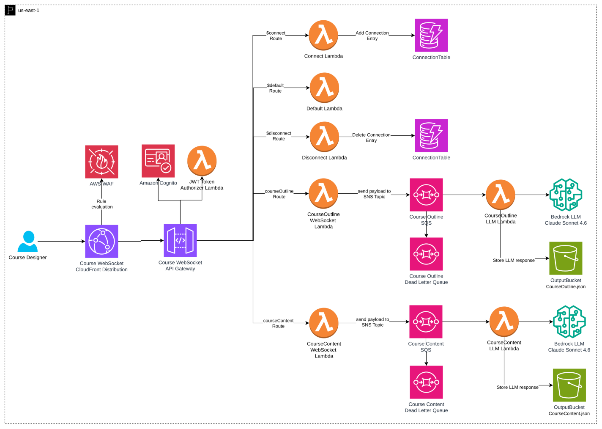
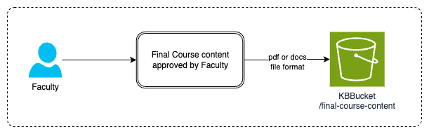
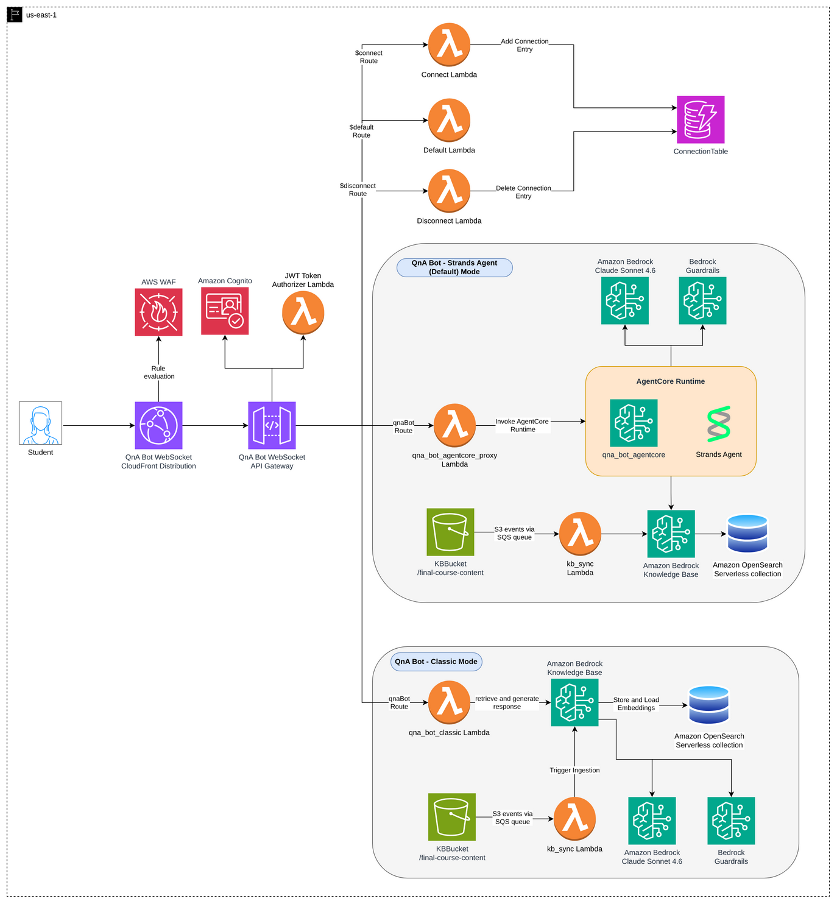
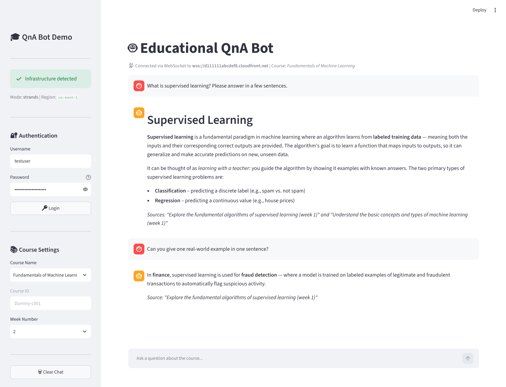

# Educational Course Content Generator with QnA Bot using Bedrock

This project provides a serverless application for generating educational course content and a question-answering bot using Amazon Bedrock. It leverages AWS services to create a scalable and secure solution for course creation and student interaction.

## Architecture Overview

The application consists of three main components, implemented across two WebSocket APIs:

**1. Course WebSocket API (`courseWSapi`):**
   - Course outline generator
   - Course content generator <br>
   Supported by:
   - AWS Lambda for processing
   - Amazon Bedrock (Converse API with Anthropic Claude Sonnet 4.6 by default) for AI content generation
   - Amazon SQS for asynchronous processing
   - Amazon S3 buckets for input documents and generated outputs



This solution handles course outline and content generation through a WebSocket API with the following components:

- Course Designer interacts via WebSocket connection through CloudFront distribution
- Security layer comprising AWS WAF and Amazon Cognito with JWT token authorization
- API Gateway WebSocket API managing different routes:
    - Connection management (connect/disconnect/default routes)
    - Course outline generation route
    - Course content generation route
- AWS Lambda functions processing each route; every request is validated before a model is called, and syllabus or reference PDFs can only be read from the solution's input bucket
- Integration with Bedrock LLM (Claude Sonnet 4.6) for AI content generation
- Amazon SQS queues with Dead Letter Queues for reliable asynchronous message handling
- S3 Output Bucket storing generated content



A streamlined content approval process that includes:

- Faculty review, finalize, and approve course content.
- Approved content is stored in a dedicated Knowledge Base S3 bucket (KBBucket) under `final-course-content/`, together with a `.metadata.json` file per document that carries `course_name`, `course_id`, `week` and `learning_objective`. Creating or removing a metadata file sends an Amazon S3 event notification to an Amazon SQS queue, from which a Lambda function starts a Knowledge Base ingestion job (see [Knowledge Base synchronization](#knowledge-base-synchronization)).
- For demonstration purposes, the sample course content in `kb_dataset/` is uploaded automatically during CDK deployment.


**2. QnA WebSocket API (`qnaWSapi`):**
   - Question-answering bot with **dual-mode support**: Strands Agent mode (default) or Classic mode <br>
   Supported by:
   - Amazon Bedrock AgentCore Runtime hosting a Strands Agent, bridged to the WebSocket API by a proxy Lambda function (Strands mode), or a single Lambda function calling the Bedrock `RetrieveAndGenerate` API (Classic mode)
   - Amazon Bedrock Knowledge Bases for retrieval of the approved course content
   - Amazon OpenSearch Serverless as the private vector store (reachable only through a VPC endpoint and by the Bedrock service)
   - Knowledge Base synchronization via an Amazon SQS queue and a Lambda function
   - S3 bucket storing approved course content as knowledge source
   - Amazon Bedrock Guardrails for content safety



### Knowledge Base synchronization

Changes in the Knowledge Base bucket reach the Knowledge Base through a queue, so that a burst of changes does not start one ingestion job per file. The path is the same in both QnA bot modes:

- **Notification:** Amazon S3 sends an event notification to an Amazon SQS queue whenever an object whose key starts with `final-course-content/` and ends in `.metadata.json` is created or removed. The queue is encrypted with SQS-managed keys (SSE-SQS), accepts TLS connections only and has a dead-letter queue. Amazon S3 usually needs about five minutes to apply a new notification configuration; a change that is made before that, such as the upload of the sample dataset during the first deployment, may produce no notification (step 3 of [Deployment](#deployment) describes how to start an ingestion job yourself).
- **Batching:** the sync Lambda function reads the queue with a batching window of 30 seconds (batch size 100, at most two concurrent invocations), so it receives up to 30 seconds of changes as one batch.
- **Coverage check:** for each batch the function takes the most recent S3 event time and lists the ten most recently started ingestion jobs of the data source. It starts a new ingestion job unless one of them started after that time and has the status `STARTING`, `IN_PROGRESS` or `COMPLETE`. An ingestion job scans the whole data source, so a job that started after a change already covers it; jobs with the status `FAILED`, `STOPPING` or `STOPPED` never count.
- **Result:** a bulk upload, such as the sample dataset at deployment, starts one ingestion job, occasionally two, instead of one per file. A second job is started when the notifications arrive in more than one batch and a later batch holds a file that was uploaded after the first job started, or when the first job failed. After a single upload, the ingestion job starts once the batching window of up to 30 seconds has passed. The bot can use the new content after that job has completed and the vector store has made the new embeddings available, which can take a few more minutes.
- **Retries:** the function does not catch Amazon Bedrock errors, such as throttling or a `StartIngestionJob` request that fails while another ingestion job is still running for the data source (the default Amazon Bedrock quota allows one concurrent ingestion job per data source). A failed invocation leaves the whole batch in the queue, which delivers it again after the visibility timeout of six and a half minutes (six times the function timeout of one minute plus the batching window, as AWS recommends for an Amazon SQS event source). A retry cannot start a duplicate job, because a job that an earlier attempt started covers the batch. After five failed attempts (about half an hour) Amazon SQS moves the messages to the dead-letter queue, which keeps them for 14 days. A message that is not an S3 event notification does not fail its batch: the function skips it with a warning.
- **Changes during a running job:** a job that started before a change does not count as covering it, so the function requests a follow-up job. If Amazon Bedrock refuses the request because the first job is still running, a retry starts the follow-up job after that job has finished. If the running job outlasts the retries, the notification ends up in the dead-letter queue and the change is ingested by the next sync: the next upload or removal, a manual sync in the Amazon Bedrock console, or a redrive of the dead-letter queue.

### QnA Bot Modes

The QnA bot supports two deployment modes, configured via `qna_bot_mode` in `project_config.json`:

| Mode | Description |
|---|---|
| **`strands`** (default) | Deploys a [Strands Agent](https://strandsagents.com/) to [Amazon Bedrock AgentCore Runtime](https://docs.aws.amazon.com/bedrock-agentcore/latest/devguide/what-is-bedrock-agentcore.html). The agent answers through a custom `search_course_materials` tool that calls the Knowledge Base `Retrieve` API with the course/week metadata filter applied server-side (`KB_MAX_RESULTS`, 3 passages per question); the model receives only the student's question and never sees the knowledge base id, result count or filter. One agent is kept per AgentCore session, so conversation context is kept per authenticated user and course for the lifetime of the AgentCore session. A proxy Lambda bridges the WebSocket API to the runtime. |
| **`classic`** | A single Lambda function calls the Amazon Bedrock `RetrieveAndGenerate` API (hybrid search with the same metadata filter and guardrail) and returns the generated answer. Each question is answered independently; there is no conversation memory. |

To switch modes, update `project_config.json` and redeploy the QnA stack:
```bash
# In project_config.json, set: "qna_bot_mode": "strands" or "classic"
cdk deploy QnAStack
```
A switch from `strands` to `classic` deletes the AgentCore Runtime; its log group stays (see [Clean up](#clean-up)).

Both WebSocket APIs share common security components (can be separated based on requirements):
- Amazon Cognito for user authentication
- AWS WAF for threat protection
- Lambda Authorizers for connection validation

Key architectural features:
- AWS Web Application Firewall (WAF) filters malicious traffic
- Amazon CloudFront serves as the WAF-protected entry point of both WebSocket APIs
- Amazon SQS enables asynchronous processing of content generation requests and buffers the Knowledge Base bucket notifications, so that a bulk upload does not start one ingestion job per file
- Amazon Bedrock (Claude Sonnet 4.6) powers the AI content generation
- DynamoDB connection tables track the active WebSocket connections (entries expire after 24 hours)

Note: While this implementation uses shared security components for demonstration purposes, in production environments you may want to implement separate Cognito user pools, WAF rules, and Lambda Authorizers for each API based on your security requirements. The sample user pool does not allow self sign-up: only an administrator can create users, as `scripts/create_cognito_user.py` and the demo do. It leaves MFA optional and does not enable the Cognito Plus feature plan (threat protection) because it adds per-MAU cost; both are documented cdk-nag suppressions to revisit before production use.

## Usage Instructions

### Installation

Prerequisites:
- Python 3.12 or later (the Lambda functions and the AgentCore Runtime use the Python 3.12 runtime).
- Node.js 22 or later and the AWS CDK CLI pinned to the tested version: `npm install -g aws-cdk@2.1146.0`. A newer CLI also works as long as it supports the cloud-assembly schema of the pinned aws-cdk-lib 2.273.0; an older one fails `cdk synth` with a schema version mismatch.
- AWS CLI configured with credentials for the target account and **us-east-1** as the default region (for example `export AWS_DEFAULT_REGION=us-east-1`). All three stacks must be deployed in us-east-1: the WAF web ACL uses the `CLOUDFRONT` scope, which can only be created there, and the stacks exchange values through CloudFormation exports, so they must share one account and region.
- [Docker](https://www.docker.com/) installed and running. `cdk synth` and `cdk deploy` bundle the Lambda layers (both modes) and the AgentCore Runtime artifact (Strands mode) inside the `public.ecr.aws/sam/build-python3.12` image (the AgentCore artifact build pins it by digest; the Lambda layer builds use the aws-lambda-python-alpha default tag). The Lambda layers target arm64, so their bundling image is built and run as `linux/arm64`. Docker Desktop emulates arm64 out of the box and arm64 hosts build the layers natively. On an x86-64 Linux host with Docker Engine but without Docker Desktop (for example an Amazon EC2 instance or a CI runner), `cdk synth` stops with `exec format error` until QEMU emulation for arm64 is registered; follow [Install QEMU manually](https://docs.docker.com/build/building/multi-platform/#install-qemu-manually) in the Docker documentation, and repeat that step after a reboot because the registration is not persistent.
- [wscat](https://github.com/websockets/wscat) for WebSocket testing from the command line (optional).

Pinned versions:
- `requirements.txt` (CDK application and the helper scripts in `scripts/`): `aws-cdk-lib==2.273.0`, `constructs==10.8.1`, `aws-cdk.aws-lambda-python-alpha==2.273.0a0`, `cdk-nag==2.38.2`, `boto3==1.43.117`
- `lambda/lambda_layer/*/requirements.txt` (deployed Lambda layers): `cryptography==50.0.2`, `langchain-core==1.6.13`, `opensearch-py==3.2.0`, `PyJWT==2.15.1`, `PyPDF2==3.0.1`, `requests-aws4auth==1.4.0`
- `lambda/qna_bot_agentcore/requirements.txt` (agent, bundled as linux/arm64 wheels for Python 3.12): `strands-agents==1.62.0`, `bedrock-agentcore==1.24.2`, `aws-opentelemetry-distro==0.21.0`
- `requirements-lambda-dev.txt` (Lambda runtime libraries for local development and testing of the handlers only; not needed to synth or deploy): `boto3==1.43.117`, `pydantic==2.14.1`, `langchain-core==1.6.13`, `langchain-community==0.4.2`, `langchain-aws==1.9.0`, `PyJWT==2.15.1`, `cryptography==50.0.2`, `PyPDF2==3.0.1`, `requests-aws4auth==1.4.0`, `opensearch-py==3.2.0`, `fsspec==2026.9.0`
- `demo/requirements.txt` (Streamlit demo): `streamlit==1.66.1`, `websocket-client==1.9.2`, `boto3==1.43.117`
- `requirements-dev.txt` (unit tests): `pytest==9.0.3`, `boto3==1.43.117`

Steps:
1. Clone the repository:
    ```
    git clone https://github.com/aws-samples/educational-course-content-generator-with-qna-bot-using-bedrock.git
    ```
2. Navigate to the project directory:
    ```
    cd educational-course-content-generator-with-qna-bot-using-bedrock
    ```
3. Create a virtual environment:
   ```
   python -m venv .venv
   ```
4. Activate the virtual environment:
   - On Windows: `.venv\Scripts\activate.bat`
   - On Unix or MacOS: `source .venv/bin/activate`
5. Install the dependencies of the CDK application and of the helper scripts in `scripts/`:
   ```
   pip install -r requirements.txt
   ```
   Only if you want to run or modify the Lambda handlers locally, also install `pip install -r requirements-lambda-dev.txt`.
6. Synthesize the CloudFormation templates for this project (Docker must be running):
    ```
    cdk synth --all
    ```
   Synthesis runs the cdk-nag `AwsSolutions` checks and writes `cdk.out/AwsSolutions-*-NagReport.csv` (one report per stack). The stacks synthesize with zero Non-Compliant findings; every suppression states the specific wildcard or setting it covers.

### Deployment

> **Updating from an earlier version of this sample:** an in-place update is not supported and was not tested. `cdk deploy` is expected to stop in `CourseStack`, because the pinned Lambda layers get new versions and CloudFormation cannot change the layer ARNs that `CourseStack` exports while `QnAStack` imports them. Copy anything that you want to keep out of the S3 buckets, delete the earlier deployment with `cdk destroy --all` (see [Clean up](#clean-up)) and deploy again. The new deployment has new CloudFront domain names and a new user pool.

1. Review and modify the `project_config.json` file to customize your deployment settings:
   - `model_id` (course generation) and `qna_model_id` (QnA bot) accept either a foundation model id or a cross-region inference profile id (prefix `us.`, `eu.`, `au.`, `jp.`, `apac.` or `global.`); the default is `us.anthropic.claude-sonnet-4-6`. The IAM permissions for the Claude model family are derived from the configured prefix, and in Classic mode the Lambda receives the resolved model ARN (`QnA_MODEL_ARN`).
   - `embeddings_model_id` defaults to `amazon.titan-embed-text-v2:0` with `embeddings_vector_size` 1024.
   - `qna_bot_mode` selects `strands` (default) or `classic`.
   - `vpc` defines the CIDR range and subnet mask of the VPC created by `CourseStack`.
   - `solution` holds the AWS solution ID, the name and the version of this sample. It is not a deployment setting (see [Solution ID and usage reporting](#solution-id-and-usage-reporting)).

   Model access: Amazon Bedrock no longer has a model access page on which models are enabled. **Amazon Titan Text Embeddings V2** needs no action. **Anthropic Claude Sonnet 4.6** is offered through AWS Marketplace and needs up to two one-time steps (see [Request access to models](https://docs.aws.amazon.com/bedrock/latest/userguide/model-access.html)):

   - Submit the Anthropic use case details, once per account or once in the management account of your organization: in the Amazon Bedrock console choose **Model catalog**, choose **Claude Sonnet 4.6**, open it in the playground and complete the form. If no form is shown, the details have already been submitted.
   - Send one prompt to the model, once per model, with an identity that has the AWS Marketplace permissions `aws-marketplace:Subscribe`, `aws-marketplace:Unsubscribe` and `aws-marketplace:ViewSubscriptions`, either in the playground or with the AWS CLI:

     ```bash
     aws bedrock-runtime converse --region us-east-1 --model-id us.anthropic.claude-sonnet-4-6 \
       --messages '[{"role":"user","content":[{"text":"Hello"}]}]'
     ```

     Amazon Bedrock creates the AWS Marketplace subscription on this first invocation. Afterwards the roles that the stacks create, which have no AWS Marketplace permissions, can invoke the model.

   If the steps are skipped in an account that has never used the model, model calls fail with `AccessDeniedException`. The WebSocket client then receives only a generic error message; the exception is in the log group of the Lambda function or, in Strands mode, in the AgentCore Runtime log group (see Observability). If you change `model_id` or `qna_model_id` to another Claude model, repeat the second step for that model.

2. Review the AWS WAF rules in `educational_course_content_generator_with_qna_bot_using_bedrock/cloudfront_waf_stack.py`. The `GeoMatch` rule **blocks every request that does not originate from a country in its `country_codes` list**, so add your own country code before deploying if it is not already in the list (the sample ships with a South American and European set plus IN, US and AE). The web ACL also limits each source IP to 100 requests per five minutes and applies the AWS managed rule groups for IP reputation, known bad inputs, SQL injection, Linux and Unix.

3. Bootstrap and deploy the stacks:
   ```
   cdk bootstrap
   cdk deploy --all
   ```
   The stacks deploy in the order `CloudFrontWAFStack`, `CourseStack`, `QnAStack`; use the same order when deploying them individually. `QnAStack` copies the sample dataset to the Knowledge Base bucket only after the sync queue, the bucket notification configuration and the sync Lambda exist, so that the upload can produce the notifications that start the first ingestion job. The notifications are batched for up to 30 seconds, and the upload normally starts one ingestion job, occasionally two (see [Knowledge Base synchronization](#knowledge-base-synchronization)). Wait for the ingestion to complete (Amazon Bedrock console > Knowledge bases > `CourseKB` > data source sync history) before asking the bot questions.

   The first ingestion job is not guaranteed. Amazon S3 usually needs about five minutes to apply a new notification configuration, and an object that is uploaded before the configuration has taken effect produces no notification. If the sync history shows no ingestion job about five minutes after `cdk deploy` has finished, start one yourself: in the Amazon Bedrock console, select the data source `KBDataSource` of `CourseKB` and choose **Sync**, or use the AWS CLI. The first two commands return the ids that the third one needs:
   ```bash
   aws bedrock-agent list-knowledge-bases --query "knowledgeBaseSummaries[?name=='CourseKB'].knowledgeBaseId" --output text
   aws bedrock-agent list-data-sources --knowledge-base-id <knowledge-base-id> --query "dataSourceSummaries[?name=='KBDataSource'].dataSourceId" --output text
   aws bedrock-agent start-ingestion-job --knowledge-base-id <knowledge-base-id> --data-source-id <data-source-id>
   ```

4. Note the stack outputs:
   - `CourseStack`: `UserPoolArn`, `UserPoolClientId`, `InputBucketName`, `OutputBucketName`, `KBBucketName`, `AccessLogsBucketName` and `CourseCloudFrontDomainName` (the `CourseWSApiEndpoint` output is the raw API Gateway endpoint, listed for reference only)
   - `QnAStack`: `QnACloudFrontDomainName`, `QnABotMode` and, in Strands mode, `AgentCoreRuntimeArn`

   Always connect through the CloudFront domain names: connecting to the `execute-api` endpoints directly bypasses AWS WAF.

   Wait a minute or two after a `cdk deploy` that creates the stacks (the first deployment, or one that follows `cdk destroy`) before you send the first questions. The `qnaBot` route is among the last resources created, and API Gateway needs a short time to make a new stage deployment effective everywhere; until then a valid `qnaBot` message can be answered by the `$default` route (`you invoked the default route!!`). Send the message again if that happens.

Configuration reference (environment variables set by the stacks):

| Component | Environment variables |
|---|---|
| AgentCore Runtime (Strands mode) | `QnA_MODEL_ID`, `KNOWLEDGE_BASE_ID`, `GUARDRAIL_ID`, `GUARDRAIL_VERSION`, `KB_MAX_RESULTS` (`3`), and three telemetry-redaction variables: `OTEL_SEMCONV_STABILITY_OPT_IN` (`gen_ai_unredacted_attributes=`, an empty allowlist that makes the Strands tracer redact prompt, completion, tool and system-prompt content), `OTEL_INSTRUMENTATION_GENAI_CAPTURE_MESSAGE_CONTENT` (`false`, stops the botocore Bedrock instrumentation from recording Converse messages; ADOT defaults it to `true` on AgentCore) and `AWS_REDACT_SPAN_ATTRIBUTES` (the `gen_ai.*` content attributes, redacted by ADOT before export as a second layer). The runtime fails fast at start-up if `KNOWLEDGE_BASE_ID` or `QnA_MODEL_ID` is missing; running `agentcore_handler.py` locally also requires `AWS_REGION`. |
| Proxy Lambda (Strands mode) | `AGENT_RUNTIME_ARN` |
| QnA Lambda (Classic mode) | `KB_ID`, `QnA_MODEL_ARN`, `GUARDRAIL_ID`, `GUARDRAIL_VERSION`, `KB_MAX_RESULTS` |
| Course outline and content Lambdas | `MODEL_ID`, `INPUT_BUCKET_NAME`, `OUTPUT_BUCKET`, `WEBSOCKET_ENDPOINT_URL`. Input documents are accepted only from `INPUT_BUCKET_NAME`; the functions fail at start-up if the variable is missing, so the restriction cannot silently disappear. |
| Every Lambda function of this repository that calls AWS, and the AgentCore Runtime | In addition to the variables above, `USER_AGENT_STRING`: the solution token that their AWS SDK clients append to the `User-Agent` header (see [Solution ID and usage reporting](#solution-id-and-usage-reporting)). The stacks do not set it when the `solution` block is deleted from `project_config.json`. The authorizers and the function that creates the vector index make no AWS SDK call and do not get it. |

### Using the Application

1. **Create a test user and get a JWT token** using the provided helper script. It reads the Cognito User Pool details from your deployed `CourseStack`, creates the user, authenticates and prints the JWT ID token together with ready-to-use `wscat` commands for both CloudFront endpoints. There is no default password: the script prompts for it with a hidden prompt (and asks for a confirmation when creating a user). The password must satisfy the user pool policy (at least 8 characters with upper-case, lower-case, digit and symbol).
   ```bash
   python scripts/create_cognito_user.py
   ```

   You can customize the username and region (the region defaults to your AWS profile's region, then us-east-1):
   ```bash
   python scripts/create_cognito_user.py --username testuser --region us-east-1
   ```

   To refresh an expired token for an existing user (tokens expire after 24 hours):
   ```bash
   python scripts/create_cognito_user.py --token-only --username testuser
   ```

   `--password` is still accepted for automation, but it puts the password in your shell history. The AWS credentials running the script need `cloudformation:DescribeStacks` and the Cognito `AdminGetUser` and `AdminCreateUser` permissions; the sign-in calls `InitiateAuth` and `RespondToAuthChallenge` are public Cognito operations that need no IAM permission. Alternatively, you can use the [cognito-user-token-helper](https://github.com/aws-samples/cognito-user-token-helper) repository or create users manually via the AWS Console.

2. Connect to the WebSocket endpoints through CloudFront using wscat (the helper script above prints the exact commands with your token). The Cognito **ID token** must be sent in the `Authorization` header of the `$connect` request; tokens passed as a query-string parameter are rejected.
   ```bash
   # QnA bot
   wscat -c "wss://<QnACloudFrontDomainName>" -H "Authorization: Bearer YOUR_JWT_TOKEN"

   # Course outline and content generation
   wscat -c "wss://<CourseCloudFrontDomainName>" -H "Authorization: Bearer YOUR_JWT_TOKEN"
   ```
   The CloudFront origin path already maps to the API's `dev` stage, so no path is needed. Do not connect to the `execute-api` endpoints directly: they bypass AWS WAF.

3. To generate a course outline:
   - Send a message to the `courseOutline` route with the required parameters (course title, duration, etc.). The request is queued in SQS and processed asynchronously; the result is posted back on the same connection.
   - The request is validated before any model call: `course_title` must be a non-empty string of at most 500 characters, `course_duration` an integer between 1 and 52, `user_prompt` at most 8000 characters, and `is_streaming` is optional (`"yes"` or `"no"`, default `"no"`).
   - `user_prompt` is rendered as a template and accepts only the placeholders `{course_title}`, `{course_duration}` and `{syllabus_text}`; write literal braces as `{{` and `}}`. Invalid templates, including positional placeholders such as `{}` or `{0}`, return a validation error frame instead of failing silently.
   - Every entry of `s3_input_uri_list` must point at the solution's input bucket (the `InputBucketName` stack output), for example `s3://<your-input-bucket-name>/syllabus.pdf`. URIs that reference any other bucket are rejected, only `.pdf` objects are read, and their text is injected as `{syllabus_text}`.
   - With `"is_streaming": "yes"` the outline JSON is delivered incrementally as the model produces it; with `"no"` it is delivered as a single message once complete. In both cases the outline is saved to the output bucket (`OutputBucketName`) under `course_outline/<course_title>/course_outline.json`.
   - **Sample course outline payload**
      ```json
      {
         "action": "courseOutline", 
         "is_streaming": "yes",
         "s3_input_uri_list": [],
         "course_title": "Fundamentals of Machine Learning",
         "course_duration": 4,
         "user_prompt": "I need help developing a {course_duration}-week course content for a {course_title} course. Please use the following syllabus to:\n\n1. If provided, refer to the syllabus text from <syllabus> tags to extract the course learning outcomes.\n2. Design each week to focus on 3 main learning outcomes.\n3. For each main learning outcome, provide 3 supporting sub-learning outcomes.\n\n<syllabus>\n\n{syllabus_text}\n\n</syllabus>\n\nEnsure that each week has 3 main learning outcomes and each of those has 3 supporting sub-learning outcomes."
      }
      ```
   - **Sample courseOutline route response**
      ```json
      {
         "course_title": "Sample Course",
         "course_duration": "X weeks",
         "weekly_outline": [
            {
                  "week": 1,
                  "main_outcomes": [
                     {
                        "outcome": "Learning Outcome 1",
                        "sub_outcomes": ["Sub-outcome 1", "Sub-outcome 2", "Sub-outcome 3"]
                     },
                     {
                        "outcome": "Learning Outcome 2",
                        "sub_outcomes": ["Sub-outcome 1", "Sub-outcome 2", "Sub-outcome 3"]
                     }
                  ]
            },
            {... similar for week 2},
            {... similar for week 3},
            {... similar for week 4},
         ]
      }
      ```

4. To generate course content:
   - Send a message to the `courseContent` route with the required parameters (course title, week number, learning outcomes, etc.). The request is queued in SQS and processed asynchronously; the result is posted back on the same connection.
   - The request is validated before any model call: `course_title` and `main_learning_outcome` must be non-empty strings of at most 500 characters, `sub_learning_outcome_list` a list with at least one entry, each a non-empty string of at most 500 characters, `week_number` an integer between 1 and 52, `user_prompt` at most 8000 characters, and `is_streaming` is optional (default `"no"`).
   - `user_prompt` accepts only the placeholders `{course_title}`, `{week_number}`, `{main_learning_outcome}`, `{sub_learning_outcome_list}` and `{additional_context}`; write literal braces as `{{` and `}}` (positional placeholders such as `{}` or `{0}` are rejected with a validation error). `{additional_context}` receives the text of the `.pdf` objects listed in `s3_input_uri_list`, which must all be located in the input bucket (`InputBucketName`).
   - The system will generate and return detailed course content, including video scripts, reading materials, and quiz questions, and save it to the output bucket under `course_content/<course_title>/<week_number>/<main_learning_outcome>/course_content.json`.
   - **Sample course content payload**
      ```json
      {
         "action":"courseContent", 
         "is_streaming": "yes",
         "s3_input_uri_list": ["s3://<your-input-bucket-name>/machine learning reference book.pdf"],
         "week_number":1,
         "course_title": "Fundamentals of Machine Learning",
         "main_learning_outcome" : "Understand the basics of machine learning and its applications",
         "sub_learning_outcome_list" : ["Define machine learning and its relationship to artificial intelligence","Identify real-world applications of machine learning","Distinguish between supervised, unsupervised, and reinforcement learning"],
         "user_prompt":"For the course {course_title}, \ngenerate Week {week_number} content for the main learning outcome:\n{main_learning_outcome}\n\nInclude the following sub-learning outcomes:\n{sub_learning_outcome_list}\n\nFor each sub-learning outcome, provide:\n- 3 video scripts, each 3 minutes long\n- 1 set of reading materials, at least one page long\n- 1 multiple-choice question per video with correct answer\n\nIf provided, refer to the information within the <additional_context> tags for any supplementary details or guidelines.\n\n<additional_context>\n{additional_context}\n</additional_context>\n\nGenerate the content without any introductory text or explanations."
      }
      ```
    - **Sample courseContent route response**
      ```json
      {
         "CourseContent":{
            "week_number":1,
            "main_learning_outcome":"Learning Outcome 1",
            "reading_material":{
               "title":"xxx title of the reading material",
               "content":"xxx reading material content"
            },
            "sub_learning_outcomes_content":[
               {
                  "sub_learning_outcome":"Sub-outcome 1",
                  "video_script":{
                     "script":"xxx video script"
                  },
                  "multiple_choice_question":{
                     "question":"xxx MCQ question",
                     "options":["option 1","option 2","option 3","option 4"],
                     "correct_answer":"option 1"
                  }
               },
               {... similar for sub_learning_outcome 2},
               {... similar for sub_learning_outcome 3},
            ]
         }
      }
      ```
   - **Error frames** (both routes): validation and generation errors are returned over the WebSocket as `{"error": "<message>", "request_id": "<Lambda request id>"}`. For validation errors the message describes the problem; for internal failures the message is generic, the request id can be used to find the detail in CloudWatch Logs, and the failed SQS message is moved to the dead-letter queue.

5. To use the QnA bot:
   - Send questions to the `qnaBot` route. The bot answers from the course content in the knowledge base, restricted by a metadata filter built from `course_name`, `course_id` and `week_number` (materials up to and including that week).
   - The request is validated: `user_question` must be a non-empty string of at most 4000 characters, `week_number` an integer between 1 and 52 (digit strings accepted), `course_name` and `course_id` required non-empty strings of at most 200 characters (a request without them is rejected with a 400 error rather than searching the whole knowledge base), and `learning_objective` an optional string of at most 200 characters. Clients may send an optional `conversation_id` (1-64 characters: letters, digits, `_` or `-`; default `default`).
   - **Session behaviour (Strands mode):** conversation context is kept per authenticated user and course for the lifetime of the AgentCore session. The context is held in memory only: with the AgentCore Runtime defaults a session ends after 15 minutes without requests, or after 8 hours at most, and the next question then starts a new conversation. The proxy Lambda derives the AgentCore session id as the SHA-256 of `<cognito sub>:<course_id>:<conversation_id>`, so any `session_id` sent in the message body is ignored; send a different `conversation_id` to keep several independent conversations for the same course. Changing `week_number` or `course_name` within a session takes effect on the next question. In Classic mode each question is answered independently.
   - The answer is returned in one frame once the agent finishes; nothing is streamed. Invalid messages return `{"error": "<message>"}` and backend failures return a generic error (details are only written to CloudWatch Logs).
   - **29-second limit:** API Gateway caps each WebSocket integration at 29 seconds. If the agent needs longer, API Gateway sends its own error frame (`"message": "Endpoint request timed out"`) instead of the answer; ask shorter or more specific questions if that happens.
   - The sample dataset contains two courses: *Fundamentals of Machine Learning* (`course_id` `Dummy-c001`, weeks 1-2) and *Strategic Balance Sheet Analysis for Investment Decision Making* (`course_id` `Dummy-c002`, weeks 1-4).
   - **Sample QnA Bot payload** (`conversation_id` is optional)
      ```json
      {
         "action": "qnaBot",
         "user_question": "What is machine learning?",
         "course_name": "Fundamentals of Machine Learning",
         "course_id": "Dummy-c001",
         "week_number": 2,
         "conversation_id": "study-session-1"
      }
      ```
   - **Sample qnaBot route response (Strands Agent and Classic mode)**
      ```json
      {
         "bot_response":"Machine learning (ML) is a subset of artificial intelligence that focuses on developing algorithms and statistical models...."
      }
      ```

### Running the tests

```bash
pip install -r requirements.txt -r requirements-dev.txt
pytest
```

`pytest.ini` points at `tests/unit`. The tests need neither Docker nor AWS credentials.

`tests/unit/test_stacks.py` synthesizes all three stacks with the feature flags of `cdk.json`, as `cdk synth` does, and with asset bundling disabled, so Docker is not required. It asserts the key resources: one Cognito user pool without self sign-up, one OpenSearch Serverless collection, one Bedrock guardrail, one AgentCore runtime in Strands mode (none in Classic mode), one CloudFront-scoped WAF web ACL, the CloudFront and Cognito outputs and the trace settings of Strands mode (active tracing on the proxy Lambda, and `logs:PutResourcePolicy` of the AgentCore execution role limited to the log groups of its runtime). It also checks what `cdk destroy` relies on (every Lambda function logs to a log group of its own stack, the role of every Lambda function is deleted before that log group and carries an inline deny of `logs:CreateLogGroup`, every log group has a 30-day retention and the `Delete` policy, the stacks own the number of log groups that [Clean up](#clean-up) states, no resource is retained and the KMS key has a 7-day waiting period) and the Knowledge Base synchronization (the queue with its dead-letter queue, SSE-SQS and TLS-only policy, the queue policy that accepts notifications from Amazon S3 only for the Knowledge Base bucket of the account, the visibility timeout, the batching settings of the event source mapping, the bucket notifications that target the queue, the sample dataset upload that waits for them and the permissions of the sync Lambda). Classic mode is synthesized as well, from a temporary directory with a patched copy of `project_config.json`, so the `bedrock:GetInferenceProfile` permission is tested without changing your configuration.

`tests/unit/test_kb_sync.py` covers the Knowledge Base sync Lambda. It loads `lambda/kb_sync/index.py` from its file and stubs the function's Bedrock client with the botocore `Stubber`, so every request is checked against the botocore service model and no AWS call is made; the tests set placeholder values for the Region and the credentials and ignore the AWS profile and configuration files of your machine. They check that a batch without S3 changes is ignored, that a job is started only when no newer starting, running or complete job covers the change, that the latest event time of a batch decides, that a bulk upload split over two batches starts a single job, that Amazon Bedrock errors fail the batch so that it is retried, and that a message that is not an S3 event notification is skipped without failing the notifications that share its batch.

`tests/unit/test_agent_handler.py` covers the AgentCore Runtime entry point. It loads `lambda/qna_bot_agentcore/agentcore_handler.py` from its file with small stand-ins for the Strands and AgentCore SDKs, which are only bundled into the runtime artifact. It checks that the guardrail options are passed with `guardrail_latest_message`, that answered turns stay in the conversation history, that a turn whose model call fails leaves no question behind in the history, that retrieved passages are labelled with their document title and a whole week number (`week 1`, not `week 1.0`) rather than their S3 location, and that an invalid request is rejected before a session is created. It also checks that the client configuration of the model carries the solution user-agent token and the read timeout of 120 seconds, that the Knowledge Base client sends the token once, and that the agent starts without the `USER_AGENT_STRING` variable.

`tests/unit/test_solution.py` and `tests/unit/test_solution_wiring.py` cover the solution ID (see [Solution ID and usage reporting](#solution-id-and-usage-reporting)). The first tests the reader, `solution.py`: the stack description, the user-agent token on the `User-Agent` header of a real request that is intercepted before it is sent, and that the ID, the version and a built token are in no other code or configuration file of the repository, and the version in no Markdown file. The second runs `app.py` as `cdk synth` does, in the configured mode and in Classic mode, and reads the synthesized templates: exactly one stack description carries the plain ID; every Lambda function of this repository whose code creates an AWS SDK client, and the AgentCore Runtime, receive the token of `project_config.json`, also when the shell has a `USER_AGENT_STRING` variable of its own. It then captures the `User-Agent` header of a request of every AWS SDK client under `lambda/` and of the helper scripts, with stand-ins for the libraries of the Lambda layers, and reads the sources as a net for clients that are added later. One test needs the packages of the agent (`lambda/qna_bot_agentcore/requirements.txt`) and is skipped without them.

`scripts/invoke_agentcore_runtime.py` is a manual helper for a deployed Strands-mode stack, not a pytest test: `python scripts/invoke_agentcore_runtime.py "What is machine learning?"` invokes the AgentCore Runtime directly and then through the proxy Lambda, stubbing the `requestContext.authorizer.sub` value that the authorizer normally supplies (the proxy returns 401 without it).


## Demo UI

A local Streamlit chat interface is included to showcase the QnA Bot end-to-end. It authenticates via Amazon Cognito, connects to the QnA WebSocket API through its CloudFront distribution with a JWT Bearer token, and renders the agent's Markdown responses with a typing effect.



The demo app provides:
- **Cognito authentication** – Logs in directly from the sidebar using the deployed User Pool (the user is created on first login if it does not exist yet)
- **Course selection** – Dropdown menus for the courses and week numbers of the sample dataset
- **Chat** – Sends each question over the authenticated WebSocket and replays the complete answer with a word-by-word typing effect (the API is request/response; the demo does not stream)
- **Markdown rendering** – Displays the agent's structured Markdown answers natively in chat bubbles
- **Conversation memory** – Sends a per-browser-session `conversation_id` with every question; **Clear Chat** starts a new conversation (a new AgentCore session for that user and course)

### Running the Demo

1. **Create a test user** (optional; the demo also creates the user on first login):
   ```bash
   python scripts/create_cognito_user.py
   ```

2. **Install demo dependencies** (from the project virtual environment):
   ```bash
   pip install -r demo/requirements.txt
   ```

3. **Launch the Streamlit app from the repository root:**
   ```bash
   streamlit run demo/app.py
   ```
   The repository's `.streamlit/config.toml` binds the server to `127.0.0.1` in headless mode, so open http://127.0.0.1:8501 yourself (no browser is opened automatically) and the UI is not reachable from other machines. It also disables Streamlit's usage statistics (`browser.gatherUsageStats = false`). Streamlit reads this file from the directory it is started in, so these settings apply only when you launch the app from the repository root. The region defaults to your AWS profile's region, falling back to us-east-1, and can be set explicitly with `streamlit run demo/app.py -- --region us-east-1` (the stacks are deployed in us-east-1).

4. **In the sidebar:**
   - The app reads `UserPoolArn` and `UserPoolClientId` from the `CourseStack` outputs and `QnABotMode` and `QnACloudFrontDomainName` from the `QnAStack` outputs, and connects to `wss://<QnACloudFrontDomainName>`
   - Enter the username and password of your Cognito user (the password is never pre-filled; the **🔑 Login** button stays disabled until both are filled) and click **🔑 Login**
   - Select a course from the dropdown (e.g., *Fundamentals of Machine Learning*)
   - Choose the week number

5. **Start asking questions in the chat!** Try questions like:
   - "What is machine learning?"
   - "Explain the difference between supervised and unsupervised learning"
   - "What are neural networks?"

> **Note:** The demo requires all stacks to be deployed and AWS credentials configured. The Streamlit app reads the Cognito and CloudFront details directly from CloudFormation stack outputs. It waits up to 35 seconds for each answer and shows a friendly message when API Gateway closes the request at its 29-second limit; ask shorter or more specific questions if that happens.

## Data Flow

1. The user connects to the CloudFront endpoint, which fronts the WebSocket API behind AWS WAF. The `$connect` Lambda authorizer verifies the Cognito ID token from the `Authorization` header and forwards the caller's identity (`sub`, `username`) to the routes.
2. The user sends a request for course outline or content generation.
3. The route Lambda queues the request in SQS; the processing Lambda validates it, reads any referenced PDFs from the input bucket and renders the user prompt template.
4. The Lambda function invokes Amazon Bedrock (Converse API with a static system prompt) to generate the requested content.
5. Generated content is stored in the output bucket and returned to the user via WebSocket. Failures produce an error frame carrying the request id, and the message is moved to the dead-letter queue.
6. For QnA, user questions are processed by the QnA bot. In Strands Agent mode, the proxy Lambda validates the question, derives the per-user session id and invokes the Bedrock AgentCore Runtime, where the Strands Agent calls `search_course_materials` to retrieve the relevant course content and answers under the Bedrock guardrail. In Classic mode, the Lambda directly calls the Bedrock `RetrieveAndGenerate` API.
7. Independently of the two WebSocket APIs, every `.metadata.json` object that is created or removed under `final-course-content/` in the Knowledge Base bucket puts an Amazon S3 event notification into the sync queue. The sync Lambda receives up to 30 seconds of notifications as one batch and starts a Knowledge Base ingestion job, unless a job that started after the latest change in the batch already covers it.

This flow supports real-time communication, secure authentication, and efficient processing of user requests for course generation and question answering.


## Security Features

The application implements multiple layers of security: AWS WAF and Amazon CloudFront in front of both WebSocket APIs, Amazon Cognito authentication with JWT-based Lambda Authorizers, QnA conversations isolated per authenticated user and course, Amazon Bedrock Guardrails for the QnA bot, a private OpenSearch Serverless collection, prompt hardening and input validation, least-privilege IAM policies, encryption and network controls, and cdk-nag checks at synthesis.

See [Security Features](docs/security-features.md) for the details of each control and for the known limitations, such as the TLS versions that CloudFront accepts with its default certificate and what the guardrail screens in a multi-turn conversation.

## Observability

- Service metrics and logs are available out of the box; traces require the bundled ADOT and a one-time enablement of CloudWatch Transaction Search, a setting for the whole account (see [Enabling CloudWatch Transaction Search](https://docs.aws.amazon.com/bedrock-agentcore/latest/devguide/observability-configure.html)). The AgentCore Runtime artifact starts with `opentelemetry-instrument agentcore_handler.py` using the bundled `aws-opentelemetry-distro`. Its logs and, once Transaction Search is enabled, its trace spans (log stream `spans`) are written to the log group `/aws/bedrock-agentcore/runtimes/<runtime-id>-DEFAULT`; in Regions where AgentCore does not yet deliver spans to the log group of the agent, and for a runtime that was created before its Region supported this, they are in the shared `aws/spans` log group. The proxy Lambda uses active tracing, because Lambda otherwise marks every request as not sampled and the runtime then records no trace for questions asked through the WebSocket API; with active tracing, Lambda makes the sampling decision itself: it traces the first request each second and 5% of the others. This rate cannot be configured, and the X-Ray sampling rules of the account do not change it (see the [AWS Lambda documentation on X-Ray tracing](https://docs.aws.amazon.com/lambda/latest/dg/services-xray.html)). The AgentCore service creates the log group of the runtime outside the stacks, so the stacks neither set a retention period on it nor delete it (see [Clean up](#clean-up)). Conversation content is kept out of telemetry at capture time: `OTEL_SEMCONV_STABILITY_OPT_IN=gen_ai_unredacted_attributes=` (an empty allowlist) makes the Strands tracer replace the student's question, the answer, tool-call arguments and results (the retrieved passages) and the system prompt with a redaction marker before they reach its spans; `OTEL_INSTRUMENTATION_GENAI_CAPTURE_MESSAGE_CONTENT=false` stops the botocore Bedrock instrumentation from recording the Converse request and response messages (ADOT turns this capture on by default when `AGENT_OBSERVABILITY_ENABLED` is set); and `AWS_REDACT_SPAN_ATTRIBUTES` lists the `gen_ai.*` content attributes that ADOT redacts before export as a safety net. AgentCore traces and logs therefore contain span metadata (timings, token counts, model id, tool names, knowledge base id) but no conversation content. Remove these variables only if you deliberately want prompts and completions in your traces, for example to run AgentCore Evaluations on them.
- Every Lambda function logs to CloudWatch Logs with metadata only (route, connection id, request id, course id, week number, payload lengths, SQS message ids, ingestion job ids). Course-generation error frames include the Lambda request id so a failure can be correlated with its log entry; failed course generation messages wait in the dead-letter queues of the two course queues (7-day retention).
- The log groups belong to the stacks: each Lambda function, including the functions that CDK adds for custom resources, writes to its own log group, and the VPC flow logs go to a log group of `CourseStack`. These log groups keep their log events for one month (`LOG_RETENTION` in `educational_course_content_generator_with_qna_bot_using_bedrock/stack_logging.py`) and are deleted with their stack. CloudFormation generates their names, which start with the stack name (for example `QnAStack-kbsynclambdaStackOwnedLogGroup...`) and not with `/aws/lambda/`. To open the logs of a function, choose **Monitor** > **View CloudWatch logs** on the function's page in the Lambda console, or list the log groups with `aws logs describe-log-groups --log-group-name-prefix QnAStack-` (or `CourseStack-`).
- CloudFront standard logs and S3 server access logs are written to the access-logs bucket (`AccessLogsBucketName`), and the WAF web ACL publishes CloudWatch metrics and sampled requests for every rule.
- Knowledge Base ingestion jobs started by the sync Lambda can be followed in the Amazon Bedrock console under the `CourseKB` data source (sync history). For every batch the sync Lambda logs one line with the outcome (`No S3 change in the batch`, `Change already covered by an ingestion job` or `Ingestion job started`), the number of SQS messages, the Lambda request id and, where they apply, the latest change time and the id and status of the ingestion job; object keys and message bodies are never logged. A batch without an S3 change is normal: Amazon S3 sends an `s3:TestEvent` message when the bucket notification is created. A message that is not an S3 event notification (a body that is not a JSON object, a `Records` member that is not a list, or a record whose `eventTime` is missing or is not an ISO 8601 time with a UTC offset) is skipped with a warning that names the SQS message id, so that it cannot fail the notifications that share its batch. The function starts ingestion jobs but does not wait for them, so nothing retries a failed job automatically; the next change or a manual sync starts a new job, which also picks up the earlier changes. Batches that failed five times wait in the dead-letter queue of the sync queue for 14 days.

## Scalability and Performance

### Scalability
- Amazon SQS supports asynchronous processing.
- AWS Lambda auto-scales dynamically.
- Amazon Bedrock AgentCore Runtime isolates and scales agent sessions.
- CloudFront absorbs connection load at the edge.
- DynamoDB on-demand capacity scales with the number of connections.

### Performance Optimization
- CloudFront terminates viewer connections at the edge; caching is disabled for the WebSocket behaviour so responses are never stale.
- WebSocket API enables real-time interaction.
- DynamoDB is designed to deliver millisecond-level query response times.
- Amazon SQS buffers high-load requests.
- API Gateway caps each WebSocket integration at 29 seconds. The course generation routes stay within it by handing requests to SQS and posting results back asynchronously; the QnA route returns the answer in a single frame once the agent finishes, so very long-running questions can hit the limit.

## Cost

This sample creates resources that are billed for as long as they exist, even when idle. The main items are:
- **Amazon OpenSearch Serverless** bills a minimum number of OCUs (OpenSearch Compute Units) while the collection is deployed, whether or not it is queried: 1 OCU (0.5 for indexing and 0.5 for search) for a collection without standby replicas, which is how this stack configures it. This is the largest fixed cost of the sample; see the Amazon OpenSearch Service pricing page for current rates. The OpenSearch Serverless VPC endpoint is an AWS PrivateLink interface endpoint billed per AZ-hour and per GB processed, in addition to the collection's minimum OCUs.
- **NAT gateways**: `CourseStack` creates a VPC with two Availability Zones and one NAT gateway per AZ, billed per hour and per GB processed.
- **Amazon CloudFront** (two distributions) and **AWS WAF** (web ACL, rules and request charges) are billed per request and per GB transferred.
- **Amazon Bedrock**: per-token charges for the Claude model and the Titan embeddings model (ingestion and queries), plus Guardrails text-unit charges. **Amazon Bedrock AgentCore Runtime** is billed for the compute consumed by active agent sessions.
- Smaller items: AWS Lambda, Amazon SQS (the course generation queues, the Knowledge Base sync queue and their dead-letter queues), DynamoDB on-demand tables, S3 storage and requests, the KMS key (monthly charge), CloudWatch Logs ingestion and storage (Lambda and VPC flow logs are kept for 30 days; the stacks set no retention period on the AgentCore Runtime log group), tracing in Strands mode (the sampled invocations of the proxy Lambda are recorded as AWS X-Ray traces; with CloudWatch Transaction Search enabled, the spans of the agent and the segments of the proxy Lambda are billed as span ingestion, see Amazon CloudWatch pricing) and Amazon Cognito monthly active users.

Delete the stacks when you are done (see Clean up).

## Clean up

Delete the three stacks with:

```bash
cdk destroy --all
```

`cdk destroy --all` deletes the stacks in dependency order (`QnAStack`, then `CourseStack`, then `CloudFrontWAFStack`); if a stack cannot be deleted because another stack still imports its exports, destroy the importing stack first.

What `cdk destroy --all` removes:

- Every resource of the three stacks; no resource has a retain policy. All four S3 buckets (input, output, Knowledge Base and access logs) have the `DESTROY` removal policy with automatic object deletion, so they are removed together with their contents; copy anything you want to keep out of the output bucket (`OutputBucketName`) first. The Cognito user pool, the DynamoDB connection tables, the SQS queues, the Knowledge Base, the OpenSearch Serverless collection and the AgentCore Runtime are deleted as well.
- The CloudWatch log groups of all Lambda functions, including the functions that CDK adds for custom resources, and the VPC flow log group. They belong to the stacks (11 log groups in `CourseStack` and 10 in `QnAStack`), keep their log events for one month and are deleted with their stack. CloudFormation deletes the role of each function before the log group of that function, and the function roles are denied `logs:CreateLogGroup`, so Lambda cannot create a log group again when it delivers the last log lines of a function.

What remains after the stacks are deleted:

- **AgentCore Runtime log groups (created in Strands mode):** the AgentCore service creates one log group per runtime, `/aws/bedrock-agentcore/runtimes/<runtime-id>-DEFAULT`. They are not part of the stacks and stay until you delete them, also after a switch to Classic mode, which deletes the runtime. There is one for every runtime, that is, for every new deployment in Strands mode and every switch back to Strands mode. List them with the first command and delete each one with the second:

  ```bash
  aws logs describe-log-groups --log-group-name-prefix /aws/bedrock-agentcore/runtimes/qna_strands_agent-
  aws logs delete-log-group --log-group-name <name>
  ```

- **KMS key:** `cdk destroy` schedules the customer managed key of the course generation queues for deletion. The key shows as *Pending deletion* in the AWS KMS console, is not billed in that state and disappears after the 7-day waiting period without any action.
- **DynamoDB backups:** both connection tables have point-in-time recovery enabled, so DynamoDB keeps a system backup of each deleted table for 35 days at no additional cost and then removes it automatically (DynamoDB console > Backups).
- **CloudWatch Transaction Search (only if you enabled it for the traces):** the setting applies to the whole account and stays enabled. The spans of the agent are in the AgentCore Runtime log group listed above or, where AgentCore uses the shared span destination for the runtime (see Observability), in the shared `aws/spans` log group, which also holds the trace segments of the proxy Lambda. Turn Transaction Search off only if nothing else in the account uses it. Without Transaction Search, the traces of the proxy Lambda are in AWS X-Ray, which deletes trace data after 30 days.
- **CDK bootstrap resources:** the bootstrap stack (`CDKToolkit`) and its staging bucket, which still holds the assets that `cdk deploy` uploaded, are shared by all CDK applications in the account and region; remove them only if nothing else uses them.
- **Leftovers of an earlier version of this sample:** earlier versions let Lambda create the function log groups outside the stacks and retained the VPC flow log group and the KMS key. If you deployed such a version, the following log groups (shown for the default stack names) stay until you delete them, also after an update to the current version: `/aws/lambda/CourseStack-*`, `/aws/lambda/QnAStack-*` and `CourseStack-DemoVPCcloudwatchLogGroup*`. If you destroyed such a deployment, its KMS key (description `KMS key for SQS queue encryption`) was retained as well; schedule its deletion in the AWS KMS console.

To confirm that no log group of the stacks is left, run the following commands after the stacks are deleted. Both should return an empty `logGroups` list; delete any log group that they still list. The names of the log groups that belong to the stacks start with the stack name, so adjust the prefix if you changed the stack names in `project_config.json`:

```bash
aws logs describe-log-groups --log-group-name-prefix CourseStack-
aws logs describe-log-groups --log-group-name-prefix QnAStack-
```

## Solution ID and usage reporting

This sample has an AWS solution ID. It lets AWS measure, in aggregate, how often the sample is deployed and how much it is used. The sample identifies itself in two places. Both take the ID, the name and the version from the `solution` block of `project_config.json`, and `educational_course_content_generator_with_qna_bot_using_bedrock/solution.py` is the only code that reads that block.

- **Stack descriptions:** the description of each CloudFormation stack starts with the solution ID in parentheses, in the form `(<id>) - <name> - <component>. Version <version>`. One installation is counted once: `QnAStack`, which depends on the other two stacks, carries the plain ID, and `CourseStack` and `CloudFrontWAFStack` carry the ID with a suffix (`<id>-course` and `<id>-waf`).
- **User agent of AWS SDK calls:** the AWS SDK clients of the sample append the token `AWSSOLUTION/<id>/<version>` to the `User-Agent` header of their requests. The stacks pass the token to the Lambda functions that call AWS and to the AgentCore Runtime in the `USER_AGENT_STRING` environment variable. The helper scripts in `scripts/` and the demo create their clients with `get_client()` from `solution.py`. A `USER_AGENT_STRING` variable in your shell replaces the token for the helper scripts and the demo; `app.py` ignores it, so a deployment always passes on the token of `project_config.json`.

Both consist only of the ID, the name and the version of the solution, which are the same constants for everyone who uses this repository. They contain nothing about you, your account or your data, and no resource tags are involved.

These calls do not carry the token:

- AWS CLI commands, such as the ones in this README. The AWS CLI has no setting for it.
- Calls of the AWS CDK CLI and of the Lambda functions that the CDK adds for custom resources, for example the upload of the sample dataset.
- Calls that AWS services make on behalf of the sample, for example the ingestion and embedding calls of the knowledge base.
- The request that creates the vector index in OpenSearch Serverless. It is a signed HTTP request, not an AWS SDK call.
- Requests that libraries send without an AWS SDK client of the sample: the export of traces and logs by the AWS Distro for OpenTelemetry in the AgentCore Runtime, and the download of the signing keys of the user pool by the Lambda authorizers.

To opt out, delete the `solution` block from `project_config.json`. The helper scripts and the demo then send their AWS SDK calls without the token, and the stacks no longer pass it to the Lambda functions and to the AgentCore Runtime. `cdk synth` then stops with an error in `app.py` until you remove the three `description=stack_description(...)` arguments or replace them with descriptions of your own, so that no stack is deployed with a description that is missing the ID by accident.

An installation that is already deployed changes only when you deploy it again (`cdk deploy --all`). Until then its Lambda functions and the agent keep sending the token, and its stacks keep their descriptions. `CloudFrontWAFStack` keeps its description after that deployment as well, until one of its resources changes, because AWS CloudFormation does not update a stack when only the description of its template changes.

The tests of the solution ID expect the block and fail without it. After you opt out, delete `tests/unit/test_solution.py` and `tests/unit/test_solution_wiring.py`.

If you add an AWS call, give its client the token. In a Lambda function or in the agent, create the client with `config=Config(user_agent_extra=os.environ.get("USER_AGENT_STRING", ""))`, as the existing clients do, and add a new Lambda function to the list at the end of its stack (`course_stack.py` or `qna_stack.py`) that passes the variable. In code that runs from a checkout, use `get_client()` or `get_resource()` from `solution.py`. A client that is created without the token works and is not attributed, so nothing fails when it runs; the unit tests check for it. To release a new version, change `version` in the `solution` block and nothing else.

## Security

See [CONTRIBUTING](CONTRIBUTING.md#security-issue-notifications) for more information.

## License

This library is licensed under the MIT-0 License. See the LICENSE file.
